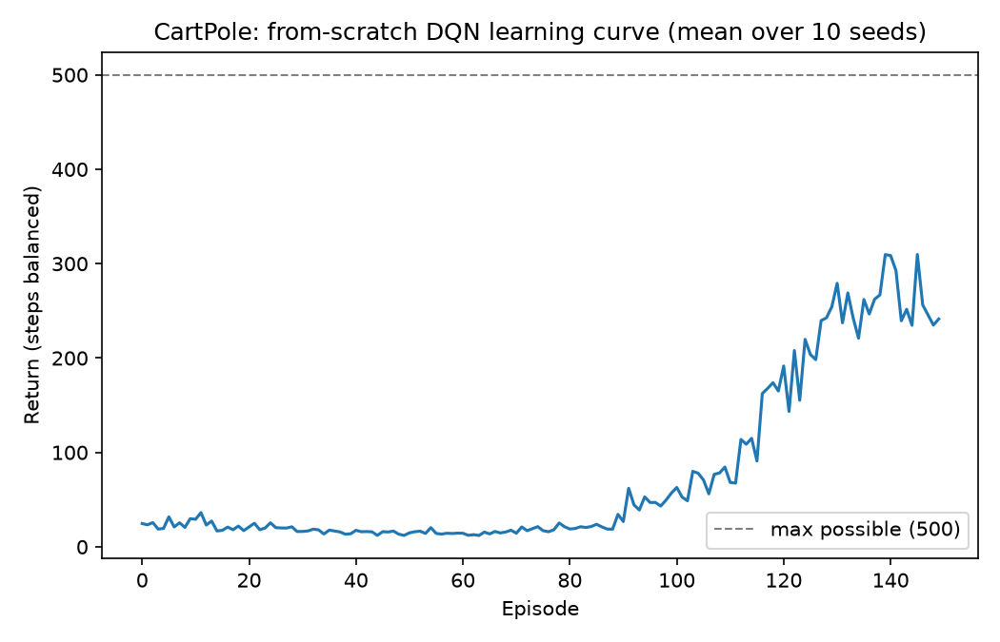
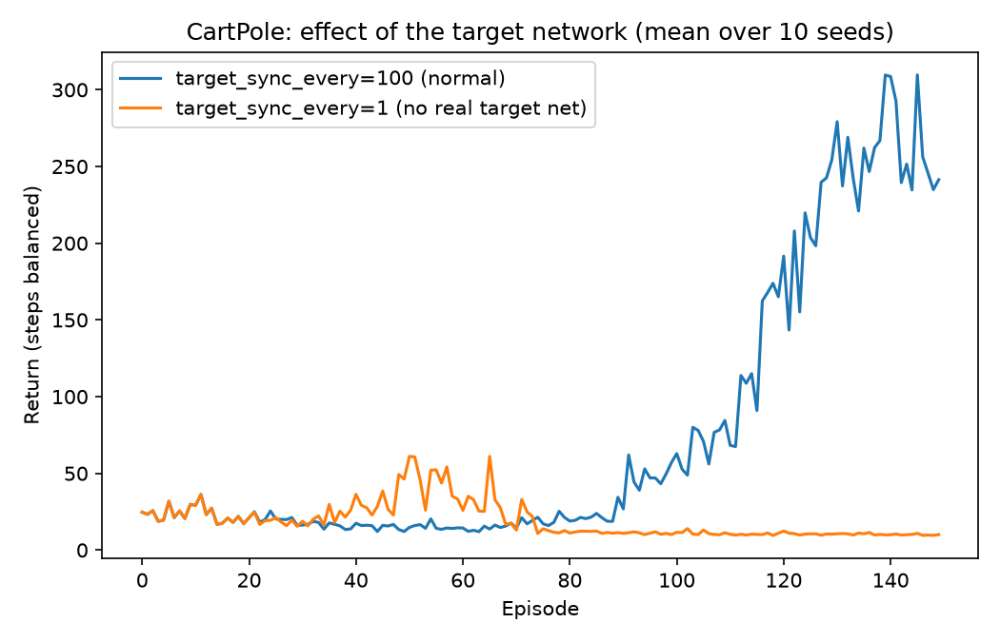

# deep-q-rl

DQN (Mnih et al., 2015) built entirely from scratch: a two-layer MLP with
the forward *and backward* pass written out by hand in numpy — no
PyTorch, no TensorFlow, no autograd — trained with experience replay and
a target network, on a self-implemented CartPole.

This is the layer above [function-approx-rl](https://github.com/ZahraAliAlharz/function-approx-rl)
in the same stack: same idea (approximate `Q(s, a)` instead of storing it
in a table), but tile coding's fixed, hand-built feature tiling is
replaced by a hidden layer that learns its own features. It's the exact
next step [social-dilemma-rl](https://github.com/ZahraAliAlharz/social-dilemma-rl)'s
README names: *"replace tabular Q-learning with a small neural Q-network
so the grid can scale past what a hashable ... view can represent."*

## Install

```bash
pip install -e ".[dev]"
pytest -q
```

## Why write backprop by hand

It's easy to call `.backward()` and never know whether your implementation
is actually correct — the training curve can look fine even with subtly
wrong gradients, especially in RL where noise already dominates the
signal. So the correctness guarantee here isn't "training looks okay,"
it's `tests/test_q_network.py::test_analytic_gradient_matches_numerical_gradient`:
a finite-difference gradient check that perturbs every weight by a small
`eps` and compares the resulting change in loss against what the
hand-derived backward pass claims the gradient is. If the manual backprop
had a sign error, a transposed matrix, or a wrong chain-rule term, this
is what would catch it — not a test that just checks the numbers go up.

## Method

- **`QNetwork`** — one hidden layer, ReLU, linear output over actions.
  The backward pass is derived by hand for the DQN loss specifically:
  only the output unit for the action actually taken gets a gradient
  signal; every other action's weights are untouched by that update
  (verified directly in `test_only_taken_action_column_changes`).
- **`ReplayBuffer`** — a fixed-size circular buffer of transitions,
  sampled uniformly at random for each mini-batch update, which breaks
  the strong correlation between consecutive steps that online updates
  would otherwise train on.
- **Target network** — a frozen copy of the online network's weights,
  resynced every `target_sync_every` steps, used only to compute the TD
  target `r + gamma * max_a' Q_target(s', a')`. Without it, the
  regression target shifts under the very update that's chasing it.

## Results

### 1. It learns to balance the pole — with the classic DQN "flat, then takeoff" shape

150 episodes, 10 seeds, hidden_dim=32, lr=0.01, target resynced every 100
steps:



| | Mean return (steps balanced, max 500) |
|---|---|
| First 10 episodes | 24.1 |
| Last 10 episodes | 261.5 |

The learning curve isn't a smooth climb — it's flat and noisy (in the
20s, roughly what an undirected bang-bang policy survives) while the
Q-function is still bad, then rises sharply once it's good enough to
actually balance. This is the real measured shape, not a projection.

### 2. The target network isn't a nice-to-have here — without it, training doesn't just slow down, it blows up



Setting `target_sync_every=1` makes the "target" network just track the
online network every single step — equivalent to having no separate
target at all, the regression target chases the same weights that are
being updated to chase it.

| | First 10 episodes | Last 10 episodes |
|---|---|---|
| With target network (sync every 100 steps) | 24.1 | 261.5 |
| Without target network (sync every step) | 24.1 | 10.1 |

I expected this to show up as *slower* convergence. What it actually
produced, on several seeds, was outright numerical divergence: Q-values
grow without bound, `np.matmul` overflows, and the run ends up propagating
`NaN`s — visible directly as `RuntimeWarning: overflow encountered in
matmul` during the run. The bootstrapped target chasing itself is exactly
the runaway feedback loop a target network exists to break, and here it
broke badly enough to produce literal numerical overflow rather than a
subtler effectiveness gap.

## Repository layout

```
src/deep_q_rl/
  envs/cartpole.py             # CartPole: pole-cart physics, reward, termination
  agents/q_network.py          # QNetwork: hand-rolled forward + backward MLP
  agents/replay_buffer.py      # ReplayBuffer: fixed-capacity circular buffer
  agents/dqn.py                 # DQNAgent: epsilon-greedy policy, target-network sync
  metrics.py                     # episode/training loops
  train.py                       # single-run CLI
experiments/
  sweep_cartpole.py              # generates both results/*.png figures
tests/                            # pytest suite, including the gradient check
```

## Usage

```bash
# Single run from the CLI
python -m deep_q_rl.train --episodes 150

# Full experiment that regenerates the figures above
python experiments/sweep_cartpole.py
```

## What I'd do next

- Add gradient clipping or a smaller learning rate schedule and see
  whether it can recover a no-target-network run from the divergence
  shown above, rather than just avoiding the problem by keeping a target
  network.
- Try Double DQN's target (use the online network to pick the
  bootstrapped action, the target network only to evaluate it) and check
  whether it reduces the overestimation bias plain DQN is known for.
- Swap the hand-rolled SGD step for a hand-rolled Adam update and compare
  sample efficiency against the plain gradient descent used here.

## References

- Mnih, V., Kavukcuoglu, K., Silver, D., et al. (2015). Human-level
  control through deep reinforcement learning. *Nature*, 518(7540),
  529-533.
- Barto, A. G., Sutton, R. S., & Anderson, C. W. (1983). Neuronlike
  adaptive elements that can solve difficult learning control problems.
  *IEEE Transactions on Systems, Man, and Cybernetics*, 13(5), 834-846 —
  original CartPole formulation.

## License

MIT — see [LICENSE](LICENSE).
